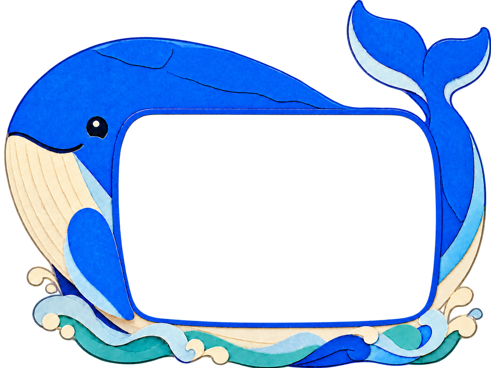

# DSH Whale Shell / 鲸鱼外壳

Windows 一键安装器与鲸鱼皮肤源码，包含 DS Bot 0.2.4、deep-view 0.1.0 和 36 张拼贴头像。**不包含 DSH 主程序、用户聊天、配置或凭证。**

## Windows 下载与范围

[下载 1.0.3 单文件安装器](downloads/windows-1.0.3/DSH鲸鱼外壳一键安装器-1.0.3.exe) · [SHA256](downloads/windows-1.0.3/SHA256SUMS.txt) · [1.0.2 历史版本](downloads/windows-1.0.2/DSH鲸鱼外壳一键安装器-1.0.2.exe)

这是未做 Authenticode 签名的 Windows 10/11 x64 安装器。仅接受已核验的 DSH **0.2.1-rc.3 和 0.2.1-rc.5** 原版或相应鲸鱼外壳，同时核对主程序与 ASAR 的精确散列，不以版本文字猜测兼容性。原版 ASAR：

- rc.3：`04b32e3a872826ba15cfb2081c6a929a8d4ecaa65e09a2543e5a6b30e2eff1f0`
- rc.5：`e1b6f25fa937da98086c3e77af77aa14791105963c4d337a1c42179d232c6915`

其他版本、混合版本或修改版会拒绝安装。目标电脑须另行安装合法取得的 DSH。安装前退出目标 DSH 及后台任务；安装器不会强停它们。成功安装、还原或恢复检查后显示完成状态，2 秒后仅关闭安装器，不自动重启 DSH。失败保留错误和恢复入口。

保留原有 Bot、头像、草稿、聊天、其他插件、provider、模型和路由。备份在实际数据目录 `whale-shell-installer/backups/`；还原只恢复安装前外壳和皮肤，保留 DS Bot、头像与新增用户数据。不同或损坏的同版插件、自定义动态/不安全目录会安全拒绝而不覆盖。

1.0.3 在同机隔离副本上通过 rc.3/rc.5 安装、升级及恢复等 13 组回归；rc.5 本地宿主通过 36 张头像和鲸鱼皮肤资源检查。图标和自动关闭的编译路径已检查，实际 GUI 自动关闭、任务栏显示和第二台物理电脑仍未验收。

## 从源码构建 Windows

从原素材构建需要 Windows x64、Node.js、Microsoft Edge、.NET Framework 4 的 C# 编译器，以及 `package-lock.json` 固定的开发依赖。也可从已核验的安装器离线提取资源再构建。完整命令与隔离验证方法见 [Windows 构建说明](implementation/installer/README-build.md)。构建和测试不调用模型；官方 DSH 程序及测试用户数据不提交到本仓库。

## Mac 状态

提供 [Mac 隔离候选源码与验证说明](mac-candidate/README.md)。Apple 芯片版针对官方 DSH 0.2.1-rc.5，Intel 版针对官方 DSH 0.2.1-rc.4；各自都已在 GitHub 标准 Mac runner 通过本地宿主与 36 张头像的无界面检查，并生成候选包。它们使用独立数据目录，不显示已有 DSH 会话、设置或 Bot，需要重新配置，也不会覆盖或重签官方 DSH。

候选尚未完成真实 Mac 桌面交互、透明区域点击穿透或 Gatekeeper 验收，也没有 Apple Developer ID 签名和公证。[测试运行与候选产物](https://github.com/sewind7-prog/dsh-whale-shell/actions/runs/41003158350)中的 Actions 下载保留 1 天；日后可按候选说明重新构建。

## 源码和许可

`implementation/` 为皮肤、精确版本外壳补丁与 Windows 打包器；`refs/` 为原鲸鱼和 36 张头像；`vendor/` 为离线第三方运行源码。项目自有代码和素材按 MIT，DS Bot/deep-view 保留 Apache-2.0。详见 [LICENSE](LICENSE)、[NOTICE](NOTICE) 和 [第三方说明](THIRD_PARTY_NOTICES.md)。
